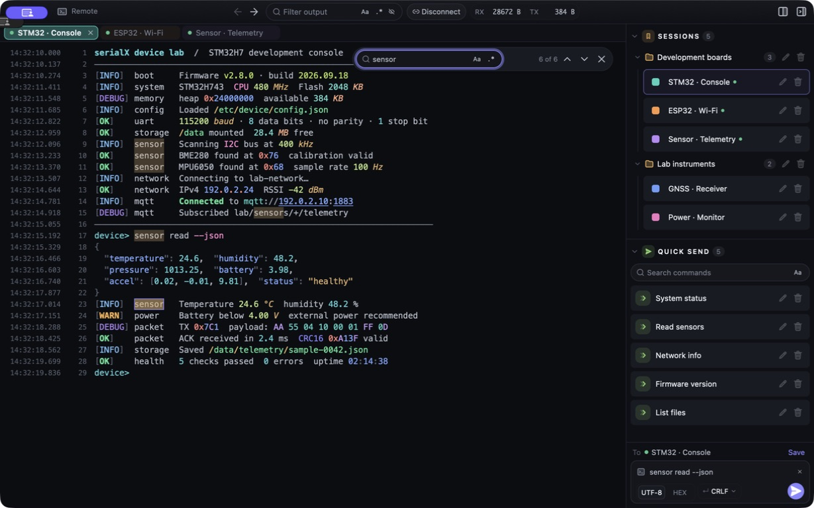
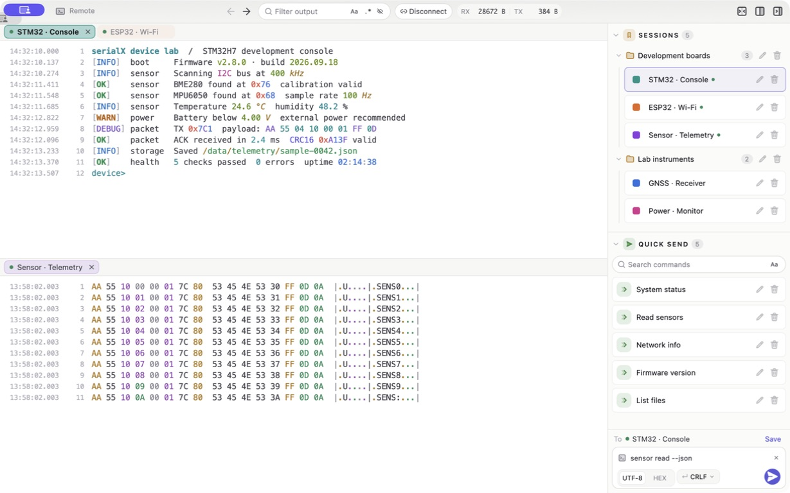

  <picture>
    <source media="(prefers-color-scheme: dark)" srcset="docs/logo-dark.svg?v=3">
    
  </picture>

<a href="README.md">English</a> · 简体中文

serialX 是一款跨平台串口工作台，使用 Rust、[GPUI](https://github.com/zed-industries/zed/tree/main/crates/gpui) 和 [GPUI Component](https://github.com/longbridge/gpui-component) 构建，支持 macOS、Windows 和 Linux。

## 应用截图

**深色主题**：彩色日志与语法高亮、关键词查找、彩色会话分组和快捷命令。

**浅色主题**：文本与十六进制分栏显示，搭配会话库、快捷发送和发送编辑框。

*截图来自实际应用界面，使用演示数据。*

## 功能

- **数据收发**：支持交互式终端、文本与十六进制视图，以及 UTF-8 / HEX 发送。
- **日志查看**：提供毫秒级时间戳、行号、语法高亮、过滤与查找，支持正则表达式。
- **会话管理**：保存串口参数，通过名称、标签色和分组整理会话。
- **快捷发送**：保存常用命令，一键发送，可设置行结束符。
- **布局与主题**：支持多标签、水平与垂直分栏、可折叠侧栏，以及明暗主题。
- **数据录制**：按连接保存原始接收字节，自动按日期归档。
- **文件传输**：支持 XMODEM、XMODEM-1K、YMODEM 和 ZMODEM，自动响应设备端的 `sz` / `rz`。
- **远程连接**：通过 SSH 使用远端串口、会话与文件，远端需具备 `python3`，无需预装代理。
- **偏好设置**：可调整日志回滚行数、终端字号及文件存放位置，支持应用内检查更新。

## 安装

前往 [Releases](https://github.com/miskin-lee/serialX/releases) 下载对应平台的安装包：

| 平台 | 安装包 |
|---|---|
| macOS（Apple Silicon） | DMG |
| Windows（x86_64） | 安装程序 / 便携版 ZIP |
| Linux（x86_64、ARM64） | DEB / 便携版 tar.gz |

安装包尚未经过 Apple 公证或 Windows 代码签名，首次启动时可能出现系统安全提示。应用会自动检查稳定版更新，也可通过 `Help > Check for Updates…` 手动检查。

## 快速上手

1. 点击标签栏的 `+` 新建会话，选择串口和通信参数，默认为 `115200 8N1`。
2. 选择 `Text` 或 `Hex` 视图，点击 `Save & Connect` 保存并连接，或点击 `Connect` 直接连接。
3. 在交互式终端中输入，或通过侧栏发送栏发送数据；常用内容可保存为快捷命令。

## 许可

serialX 以 GNU GPL v3 发布。应用图标与应用名称不适用该开源许可，版权 © 2026 miskin。
